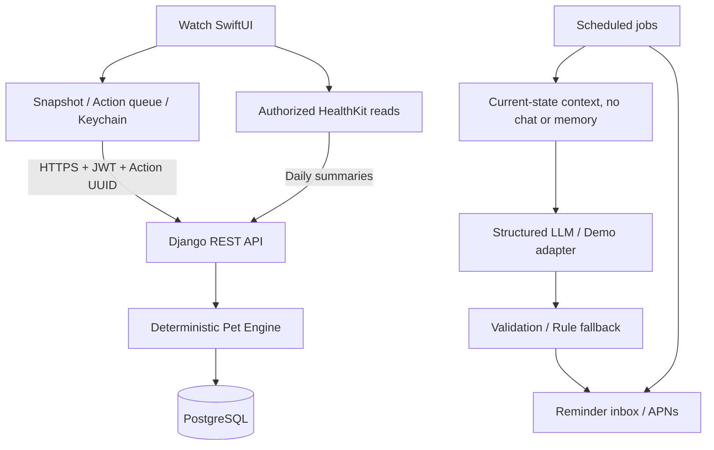

# HabitPet / Mochi

**Your habits are its life.** A native Apple Watch virtual pet powered by real-world habits, a Django REST backend, and PostgreSQL storage.

Start with the **[step-by-step user guide](docs/USER_GUIDE.md)**.

## Features

- Deterministic pet rules: fullness and hydration decay, feeding, bond, XP, levels, evolution, death, and rebirth.
- Daily habits, progress, inventory, reward ledger, user isolation, transactional updates, and idempotent action IDs.
- Daily Fitness from HealthKit steps and main sleep, with missing-data protection and missed-day settlement.
- Focus sessions; a persistent Watch focus timer, offline action queue, and explicit conflict handling.
- SwiftUI screens, HealthKit integration, Keychain credentials, notifications, and account deletion.
- Optional AI-generated remote reminders with personality, structured replies, and fallback messages.
- Local daily Schedule reminders with Mochi notification cards; remote reminder quiet hours, deduplication, and optional APNs delivery.
- Docker Compose, CI configuration, deployment instructions, PostgreSQL integration tests, Swift core checks, and A/B/C evaluation tools.

The app, built-in messages, AI response instructions, demo data, and documentation are in English. User-authored habits and schedules retain the content their owners entered. Chat, diaries, and memory management have been removed from the app.

## Current AI usage

Care actions update immediately; optional Gemini speech is requested separately after sync. Saving a Schedule generates and caches a personality-based reminder for notification delivery. With `run_jobs` running in live mode, the backend can also generate hunger, water, or unfinished-habit reminders. APNs configuration is needed for remote delivery.

Care actions save locally and synchronize in the background. A pending count means the server has not confirmed those actions; it is unrelated to Gemini. Connection failures include an English explanation. Requests use an 8-second request timeout and a 12-second resource timeout; navigation is not locked by action synchronization.

## Verification status

See [verification and remaining work](docs/VERIFICATION.md). Source delivery, simulator builds, physical-device validation, and production deployment are separate milestones.

The initial implementation was tested against an isolated PostgreSQL 18/pgvector 0.8.2 instance. Xcode has since been installed; the latest English-version build results are recorded in the verification document. Real AI provider behavior, APNs delivery, Docker execution, and physical-device HealthKit behavior require their respective credentials or environments.

## Start on this Mac

```sh
cd /Users/a33/Downloads/virtualpet
.venv/bin/python scripts/local_db.py start
scripts/manage.sh migrate
scripts/dev.sh
```

Open `http://127.0.0.1:8000/healthz/`. In another terminal, run `.venv/bin/python scripts/smoke_api.py` to exercise the real HTTP workflow.

Docker alternative: run `python3 scripts/create_env.py`, then `docker compose up --build`.

## Repository layout

```text
backend/config/               Settings, routes, and WSGI
backend/core/engine.py        Pure game rules
backend/core/services.py      Transactions, snapshots, and actions
backend/core/models.py        Persistent data models
backend/core/ai.py            Provider adapter and legacy research helpers
backend/core/jobs.py          Optional AI remote reminders
backend/core/push.py          Optional APNs delivery
backend/core/tests/           Unit and PostgreSQL integration tests
watch/HabitPet.xcodeproj/     Xcode project
watch/HabitPet/Core/          Independently testable shared logic
watch/HabitPet/               SwiftUI, HealthKit, networking, and storage
scripts/                     Startup, checks, smoke tests, and project tools
evaluation/                  Fixed scenarios, results, and rating templates
docs/                        User guide, API, architecture, and deployment
work/                        Local database, build caches, and logs (ignored)
```

## Architecture



## Design boundaries

- AI never changes game values. Suggested actions require a user action before submission.
- The server owns authoritative state. Offline behavior is a provisional projection and ordered replay, not a multi-device CRDT.
- Offline actions settle on the server's current local day. They do not backdate rewards or reverse death. Actions older than seven days are rejected.
- Watch focus completion is user-confirmed, not an anti-cheating mechanism. Separate server focus endpoints validate elapsed time.
- Health data is not used for medical diagnosis. Sharing summaries with AI requires a separate opt-in.
- Demo replies and lexical hash vectors are clearly labeled. They do not demonstrate real semantic memory quality.
- Chat, diary, and memory endpoints are removed. Existing historical database rows and optional research tools are retained; normal app flows do not access them.
- Initial evolution uses relative study/activity counts, not a learned behavioral model.

## Documentation

- [Step-by-step guide and responsibilities](docs/USER_GUIDE.md)
- [API contract](docs/API.md)
- [Implementation decisions](docs/IMPLEMENTATION.md)
- [Deployment and backups](docs/DEPLOYMENT.md)
- [Verification and remaining work](docs/VERIFICATION.md)
- [Demo recording guide](docs/DEMO.md)

No remote Git repository or public deployment was created during the initial implementation.

## Pet identity and growth

Choose **Potato** or **Cat** in **My pet**; both use your own image files, with no built-in drawn cat. Age is automatic; name, species, and Personality remain editable. Food and Toy rewards are selected after each daily completion and become concrete inventory items. See [asset replacement](docs/ASSETS.md) and [current mechanics](docs/PET_SYSTEM.md). Apply migration 0006 before using this version on another backend.
