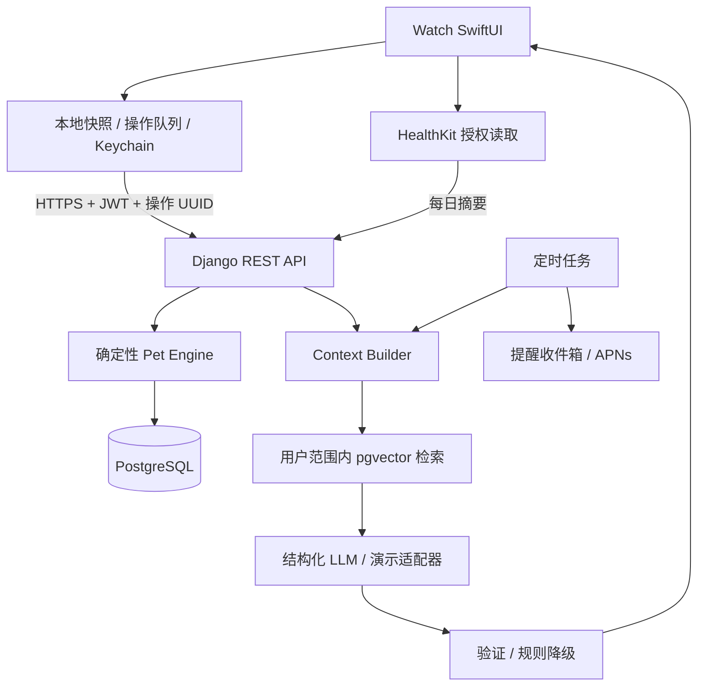

# HabitPet / Mochi

**Your habits are its life.** 原生 Apple Watch 习惯养成宠物，Django REST 后端，PostgreSQL/pgvector 长期记忆。

从这里开始：**[中文手把手指南](docs/USER_GUIDE.zh-CN.md)**。

## 已实现

- 确定性养成规则：饱腹/饮水衰减、喂食、关系、经验、等级、进化、死亡与重生。
- 每日习惯、进度、库存、奖励账本、用户隔离、事务串行化、操作 UUID 幂等。
- 健康摘要：步数档位、睡眠精力、缺失数据区分、旧摘要保护。
- Focus/Walk 服务端会话；Watch 本地持久化专注计时器、离线操作队列、冲突处理。
- SwiftUI Watch 界面、HealthKit、Keychain、通知和账号删除。
- AI 人格/上下文/结构化输出/降级；记忆证据、向量检索、查看删除。
- 日记、安静时段、提醒去重、可选 APNs 发送与重试。
- Docker Compose、CI、部署配置、真实 PostgreSQL 集成测试、Swift 核心检查、A/B/C 评估脚本。

## 验证状态

见 [验证记录](docs/VERIFICATION.md)。**源码可交付不等于已完成真机验证或上线。**

当前没有完整 Xcode/watchOS SDK，Watch UI 仅完成语法检查；共享核心和网络/Keychain 层可在本机编译。没有真实 AI/APNs 凭证，因此真实服务效果和远程通知尚未验证。Docker Desktop 无法启动，使用隔离本地 PostgreSQL 18 + pgvector 0.8.2 完成后端测试。

## 当前电脑快速启动

```sh
cd /Users/a33/Downloads/virtualpet
.venv/bin/python scripts/local_db.py start
scripts/manage.sh migrate
scripts/dev.sh
```

健康检查：`http://127.0.0.1:8000/healthz/`。新终端执行 `.venv/bin/python scripts/smoke_api.py` 验证真实 HTTP 操作。

Docker 路线：`python3 scripts/create_env.py` 后 `docker compose up --build`。

## 项目结构

```text
backend/config/               配置、路由、WSGI
backend/core/engine.py        独立游戏规则
backend/core/services.py      数据库事务、聚合状态与操作
backend/core/models.py        数据模型
backend/core/ai.py            模型适配、记忆、检索、上下文
backend/core/jobs.py          日记与提醒
backend/core/push.py          APNs 可选发送
backend/core/tests/           单元与 PostgreSQL 集成测试
watch/HabitPet.xcodeproj/     可打开的 Xcode 工程
watch/HabitPet/Core/          可独立编译测试的共享逻辑
watch/HabitPet/               SwiftUI、HealthKit、网络和存储
scripts/                     启动、检查、冒烟、项目生成脚本
evaluation/                  固定场景、结果和盲评模板
docs/                        中文手册、接口、架构和部署
work/                        本机数据库、构建缓存、日志（不提交）
```

## 架构



## 设计边界

- AI 不能修改数值，动作只做建议，用户点击后才提交。
- 后端为权威状态。离线支持的是临时预测和有序回放，不声称多设备 CRDT。
- 离线事件按服务端收到的当天结算；不补发历史奖励，不回滚死亡，最长接收 7 天内操作。
- Watch 本地专注完成由用户确认，不宣称防作弊。服务端另提供严格时长检查的 focus 会话接口。
- 健康数据不是医疗诊断输入；对 AI 发送摘要有独立开关。
- 默认使用明确标记的演示回复和 hash 向量；不能用于证明语义记忆效果。
- 日记每天首次生成后固定；晚间后台自动生成，手动提前生成则是截至当时的记录。
- 第一版进化按学习和活动的相对累计次数决定，非训练出的行为模型。

## 文档

- [手把手操作与分工](docs/USER_GUIDE.zh-CN.md)
- [API 合同](docs/API.md)
- [实现决策](docs/IMPLEMENTATION.md)
- [部署与备份](docs/DEPLOYMENT.md)
- [验证记录及待办](docs/VERIFICATION.md)
- [演示脚本](docs/DEMO.md)

未设置远程 Git 仓库，未上传个人数据，未发布到公网或 App Store。
